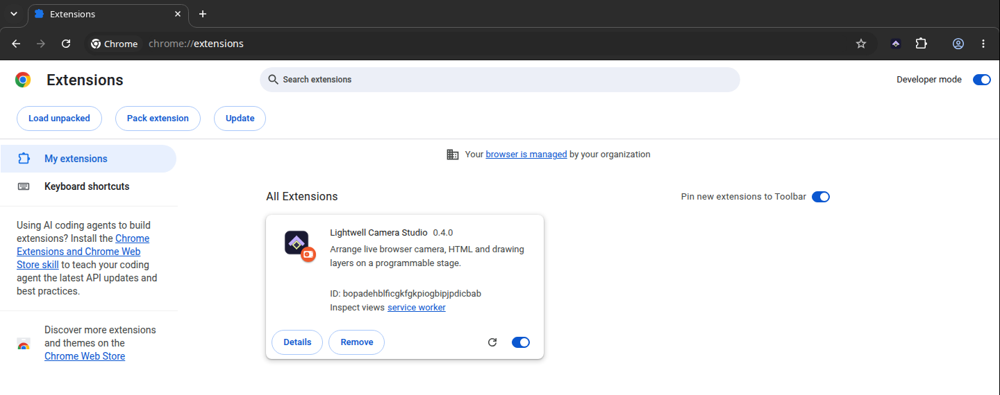
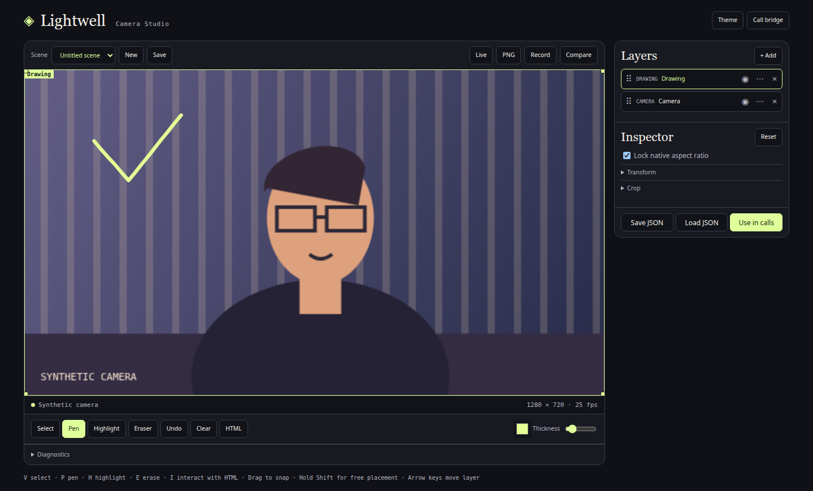
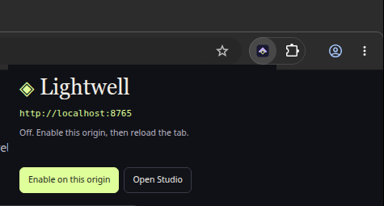
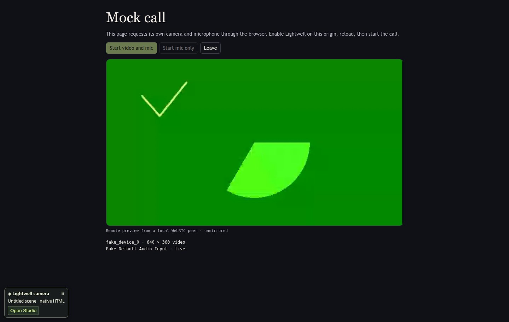

# Lightwell Camera Studio

Lightwell lets you change the picture you send in a browser video call. You can move your camera picture, add an image or text, and draw on top. The call website still uses its own microphone.

Use Chrome or Microsoft Edge, version 157 or later. Lightwell is experimental. The local test call works. Google Meet, Microsoft Teams and Zoom in the browser still need testing.

## Install Lightwell

1. On the [Lightwell GitHub page](https://github.com/sanand0/lightwell), select **Code**, then **Download ZIP**.
2. Extract the ZIP file. Keep the extracted folder.
3. Type `chrome://extensions` in the Chrome address bar and press Enter. In Edge, use `edge://extensions`.
4. Turn on **Developer mode**. Select **Load unpacked**.
5. Select the extracted folder that contains the file `manifest.json`. The browser adds **Lightwell Camera Studio** to the extensions page.
6. If the Lightwell icon is missing from the toolbar, open **Extensions**. Find **Lightwell Camera Studio**. In Chrome, select the pin next to it. In Edge, select **Show in toolbar**.

[Chrome installation help](https://developer.chrome.com/docs/extensions/get-started/tutorial/hello-world#load-unpacked)

## Make a picture in Studio

1. Select the purple and green Lightwell icon in the browser toolbar.
2. Select **Open Studio**.
3. Look at the large preview. The person you see at first is a built-in sample. It lets you try Studio with your webcam off.
4. To practise, select **Pen** and draw on the preview. Select **Undo** to remove the last stroke.
5. Select **Save**, enter a name, then select **Save scene**. A *scene* is an arrangement of camera, images, text and drawings. To open a saved scene again, choose its name from the **Scene** list.

To see your webcam in Studio, select **Camera** in **Layers**. In **Source**, choose **Default webcam**, then select **Start camera**. Allow camera access if the browser asks. You can also leave Studio on the sample and start your webcam from the call website.

### Add or move something

- Select **+ Add** in **Layers**. Choose **Media** for an image or video, **Markdown** for text, or **Display capture** for a browser tab, window or screen. Choose the file or enter your text in **Source**. For a screen or window, select **Choose display**.
- Select **Select** below the preview. Drag an item to move it. Drag a corner to resize it.
- Items at the top of the **Layers** list appear in front. Drag the grip beside a layer to change its order. Use the eye button to hide or show it.
- Use **PNG** to save a picture of the preview. Use **Record** to save up to 8 seconds of video without sound.

## Send the picture to a call

1. Open the call website in your browser.
2. With that tab open, select the Lightwell toolbar icon. Check that the menu shows the website you want to use.
3. Select **Enable on this origin**. This turns Lightwell on for the website shown in the menu. Select **Allow** if the browser asks for access.
4. Select **Reload tab**. If the permission prompt closed the menu, select the Lightwell icon again to find this button. Look for the **Lightwell camera** box on the page. It has an **Open Studio** button if you need it.
5. In Studio, select **Use in calls**. This sends the current scene to websites where you have enabled Lightwell.
6. Return to the call website and turn on its camera as usual.

Changes in Studio stay in your draft until you select **Use in calls** again. To send changes as you make them, turn on **Live** in Studio. Turn it off to edit privately. Calls keep showing the last scene you sent.

If the call shows your usual camera picture, check that Lightwell is on for that website. Reload the call tab and start its camera again. In Studio, select **Use in calls**. If you still see the usual picture, try the local test call to check your setup.

### Stop sharing

- Turn off the camera or leave the call on the call website.
- If you started a webcam or screen share in Studio, select **Stop captures** in Studio. These sources can keep running after you close the Studio tab.
- To turn off Lightwell for a website, open that website, select the Lightwell icon, then select **Disable on this origin**.

A website you enable can read the picture and scene details you send to it. Enable Lightwell only on websites you trust.

## Try a local test call

The local test shows what the other end of a call receives. It runs on your computer. Use it before trying Lightwell on a meeting website.

1. Install [Node.js](https://nodejs.org/en/download) if you need it.
2. Open a terminal in the extracted Lightwell folder. Type `npm run dev` and press Enter. Keep the terminal open.
3. Open [the local test call](http://localhost:8765/mock-call.html) in Chrome or Edge.
4. Follow [Send the picture to a call](#send-the-picture-to-a-call). For step 6, select **Start video and mic**. Allow camera and microphone access if the browser asks.
5. Check the preview below the buttons. It shows the video received by the test call. When you finish, select **Leave**. To stop the test page, return to the terminal and press Ctrl+C.

The screenshot uses a green test camera. In your test, the preview shows your webcam with the items you added in Studio.

[Developer notes and test commands](docs/development.md)
